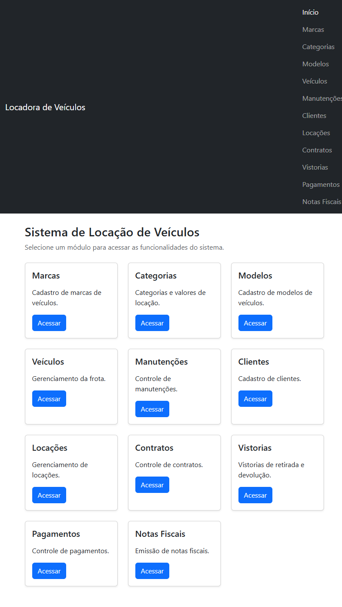
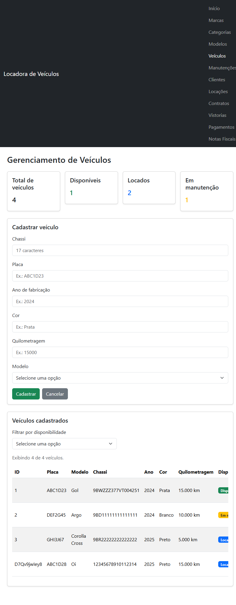
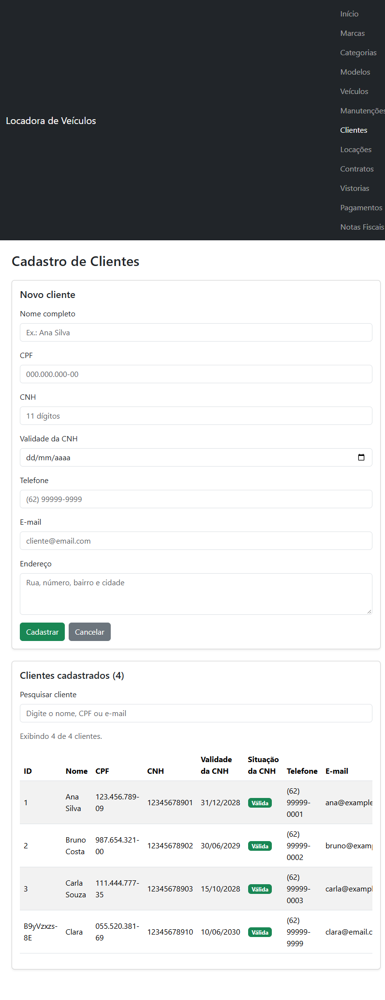
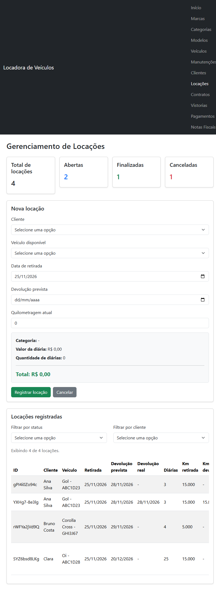
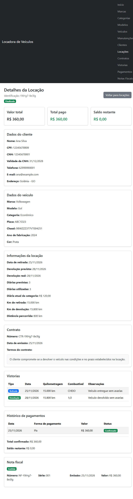
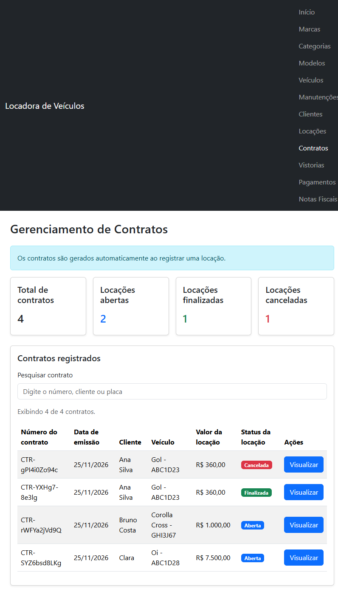
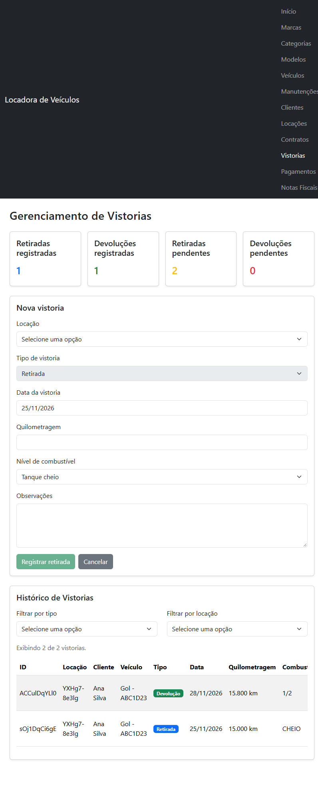
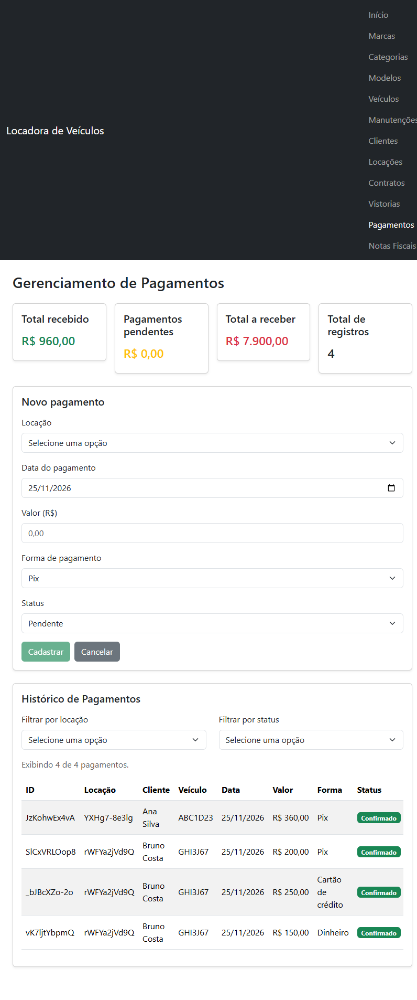
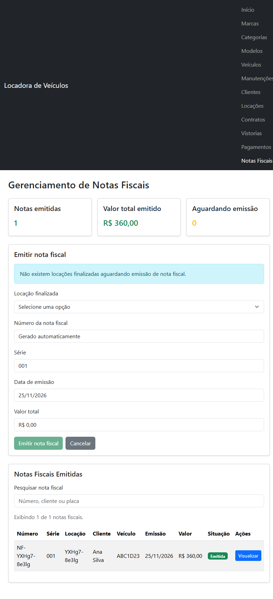

# Sistema de Locação de Veículos

Projeto desenvolvido para a disciplina de Tecnologia de Construção de Software, com o objetivo de gerenciar uma locadora de veículos, desde o cadastro da frota e dos clientes até a finalização das locações.

## Autora

Clara Morais

## Tecnologias utilizadas

- React
- TypeScript
- Vite
- Bootstrap
- React Router
- JSON Server
- Fetch API

## Funcionalidades

- Cadastro de marcas, categorias, modelos e veículos.
- Cadastro de clientes.
- Registro e histórico de manutenções.
- Controle de disponibilidade dos veículos.
- Registro de locações.
- Cálculo automático do valor das diárias.
- Geração automática de contratos.
- Vistorias de retirada e devolução.
- Registro e controle de pagamentos.
- Emissão simulada de notas fiscais.
- Consulta e detalhamento das locações.
- Filtros de pesquisa.

## Regras de negócio

- Não é permitido locar um veículo que já possui uma locação aberta.
- A data prevista de devolução deve ser posterior à data de retirada.
- Clientes com CNH vencida não podem realizar locações.
- A quilometragem de devolução não pode ser inferior à de retirada.
- Notas fiscais somente podem ser emitidas para locações finalizadas.
- Registros com dependências não podem ser excluídos.

## Estrutura do projeto

```text
locadora-veiculos/
├── src/
│   ├── components/
│   ├── models/
│   ├── pages/
│   ├── routers/
│   ├── service/
│   ├── App.tsx
│   └── main.tsx
├── db.json
├── package.json
└── README.md
```

## Como executar

É necessário ter o Node.js e o npm instalados.

### Instalar as dependências

```bash
npm install
```

### Iniciar o JSON Server

```bash
npm run server
```

A API estará disponível em `http://localhost:3001`.

### Iniciar o frontend

Em outro terminal, execute:

```bash
npm run dev
```

A aplicação estará disponível em `http://localhost:5173`, caso a porta esteja livre.

## Verificação do código

```bash
npx tsc --noEmit -p tsconfig.app.json
npm run lint
npm run build
```

## Capturas de tela

### Página inicial



### Veículos



### Clientes



### Locações



### Detalhes da locação



### Contratos



### Vistorias



### Pagamentos



### Notas fiscais



## Considerações finais

O sistema foi desenvolvido utilizando componentes reutilizáveis, interfaces TypeScript e separação entre as camadas de apresentação, modelos e serviços.

O JSON Server foi utilizado para simular uma API REST e armazenar os dados da aplicação. O projeto possui finalidade acadêmica.